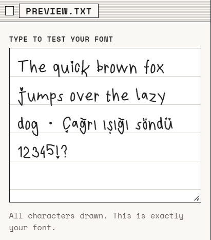
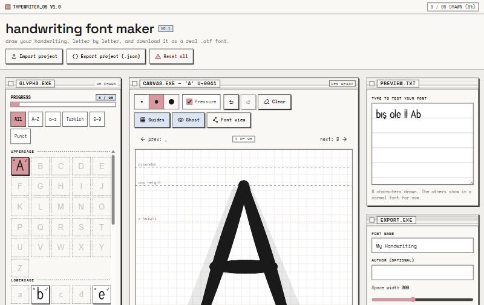

# handwriting font maker

Draw your own handwriting letter by letter and download it as a real font file (`.otf`).
It works in Canva, Word, on your computer and in game engines like Unity (TextMeshPro).

Everything runs in your browser. Nothing is uploaded, and there are no accounts.

**Try it:** https://mervekaymk.github.io/handwriting-font-maker/



*A font I drew with it, shown in the live preview.*



## Features

- 96 characters: `A–Z`, `a–z`, Turkish `Ç Ğ İ Ö Ş Ü ç ğ ı ö ş ü` (with `İ` and `ı` as their own letters), digits and common punctuation, plus an adjustable space.
- Draw with a mouse, finger or Apple Pencil. Pen pressure changes the line width (can be turned off).
- Guide lines (ascender, cap height, x-height, baseline, descender) and a faint reference letter to trace over.
- Undo / redo / clear per character, three brush sizes, left / right spacing per character.
- Live preview: type anything and see it in the font you are making.
- Auto-save in the browser. Export / import your project as a `.json` file.
- "Font view" shows the exact outline that goes into the font.

## How to use

1. Pick a character on the left and draw it on the canvas. Press **Next character** to move on.
2. Type in **PREVIEW.TXT** to check how it looks. Adjust spacing with the sliders under the canvas.
3. Give your font a name and press **Download .otf**. Empty characters are listed, but you can always download.

### Installing the font

- **Windows / macOS:** double-click the `.otf` file and choose *Install*.
  Tip: when you test several versions, give each one a new name. Systems sometimes keep showing an old version with the same name.
- **Canva:** upload the `.otf` under *Brand Kit → Fonts* (custom fonts may need a paid Canva plan).
- **Unity:** drop the `.otf` into your project and create a TextMeshPro font asset from it.

Fonts you draw belong to you.

## Run locally

It's a static site with no build step. Serve the folder with any static web server, for example:

```bash
python -m http.server 8000
```

Then open http://localhost:8000. (Opening `index.html` directly as a file does not work, because browsers block JavaScript modules from `file://`.)

## How it works

Plain HTML, CSS and JavaScript modules. No framework and no bundler. Third-party libraries are pinned and kept in [`vendor/`](vendor/):

| Library | Version | Used for |
| --- | --- | --- |
| [perfect-freehand](https://github.com/steveruizok/perfect-freehand) | 1.2.2 | Turns pen points (with pressure) into the outline of a stroke |
| [polygon-clipping](https://github.com/mfogel/polygon-clipping) | 0.15.7 | Merges all strokes of a character into one clean shape |
| [opentype.js](https://github.com/opentypejs/opentype.js) | 1.3.4 | Builds the `.otf` font file |

**From drawing to font outline (no bitmap tracing).** Strokes are stored as points in font units, not as pixels.
Each stroke's outline comes from perfect-freehand, which is the same shape you see on screen.
Then, for each character:

1. All stroke outlines are merged (union), so overlapping strokes don't leave holes.
2. Each outline is simplified, and tiny specks are removed with a minimum-area filter.
3. Outlines are oriented (outer counter-clockwise, holes clockwise, as CFF fonts expect).
4. They are turned into smooth curves, keeping sharp corners sharp.

I chose this over potrace-style tracing because it is exact: what you draw is what ends up in the font, with no resolution or blur issues.

Font metrics: 1000 units per em, ascender 800, cap height 700, x-height 500, descender −200 (see [`src/config.js`](src/config.js)).

| File | What it does |
| --- | --- |
| `src/glyphs.js` | the character list |
| `src/canvas.js` | drawing and pointer input |
| `src/stroke.js` | stroke shapes |
| `src/outline.js` | merge / clean outlines |
| `src/fontbuild.js` | builds the font |
| `src/preview.js` | live preview |
| `src/storage.js`, `src/project.js` | saving and project files |
| `src/main.js` | connects everything to the page |

## Known limitations

- No kerning. Spacing is set per character with the left / right sliders.
- Undo history is per character and is lost on page reload. The drawings themselves are saved.
- Palm rejection is simple: once a pen has been used, finger touches on the canvas are ignored until the page is reloaded.
- Drawings are saved only in this browser on this device. Use *Export project* to move them or keep a backup.
- So far tested mainly in desktop Chrome. iPad Safari + Apple Pencil, Firefox and Canva / Unity still need real-world testing.

## License

Code: [MIT](LICENSE). The vendored libraries keep their own MIT licenses (see `vendor/*-LICENSE.txt`).
